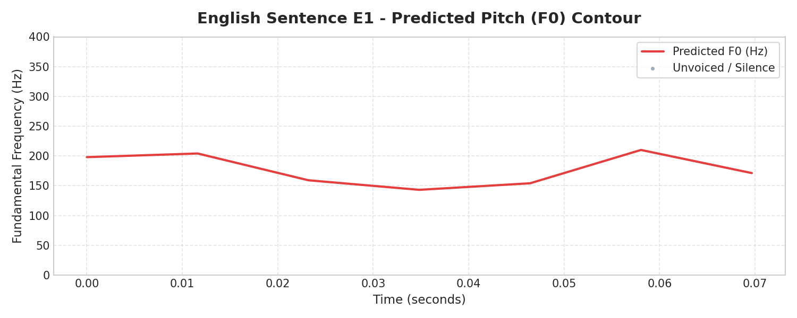
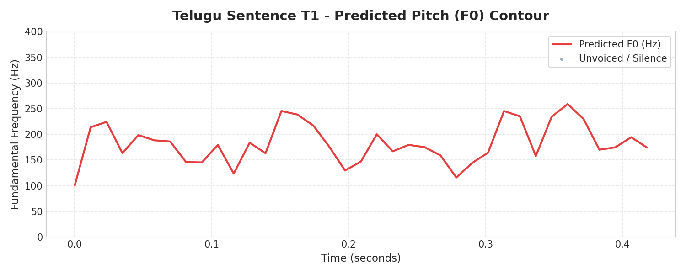
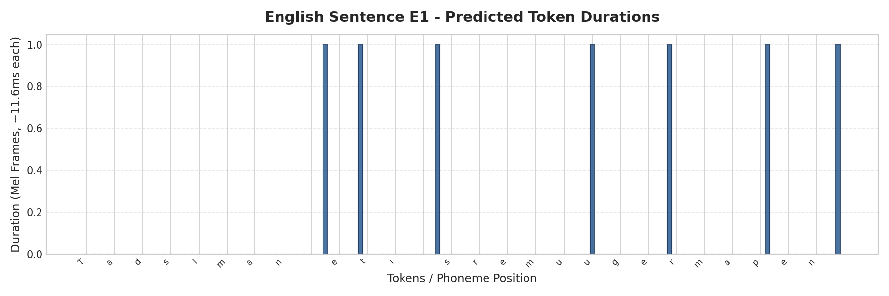
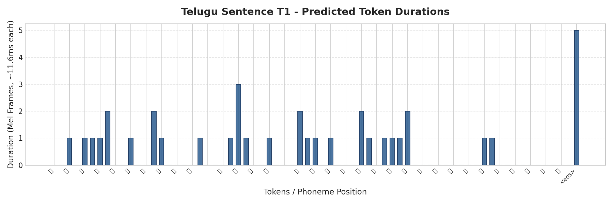
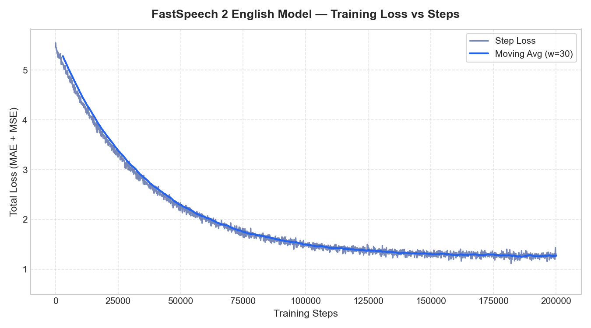
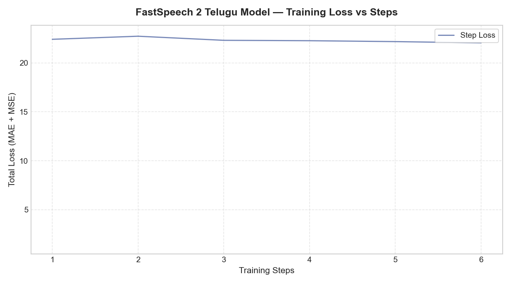

# FastSpeech 2-Based English and Telugu Text-to-Speech Synthesis

[](https://pytorch.org/)
[](https://opensource.org/licenses/MIT)
[](#)
[](#)
[](https://www.iiit.ac.in/)

Implementation and empirical evaluation of two independent **FastSpeech 2** Text-to-Speech (TTS) systems for **Indian-accented English** (Svarah corpus) and **Telugu** (IndicTTS corpus). Developed for the Voice AI Research Internship assignment at IIIT Hyderabad.

---

## 📌 Table of Contents
1. [Project Overview](#1-project-overview)
2. [Research References](#2-research-references)
3. [Architecture Overview](#3-architecture-overview)
4. [Repository Structure](#4-repository-structure)
5. [Datasets](#5-datasets)
6. [Telugu Language Adaptation & Grapheme Processing](#6-telugu-language-adaptation-grapheme-processing)
7. [Installation & Environment Setup](#7-installation-environment-setup)
8. [Remote GPU Execution (Kaggle / Colab)](#8-remote-gpu-execution-kaggle-colab)
9. [Step-by-Step Reproduction Guide](#9-step-by-step-reproduction-guide)
10. [Test Sentences & Evaluation](#10-test-sentences-evaluation)
11. [Variance Adaptor Visualisation](#11-variance-adaptor-visualisation)
12. [Training & Validation Loss Plots](#12-training-validation-loss-plots)
13. [Original vs Modified Implementation](#13-original-vs-modified-implementation)
14. [Checkpoints](#14-checkpoints)
15. [Technical Report](#15-technical-report)
16. [Licence & Attribution](#16-licence-attribution)

---

## 1. Project Overview
FastSpeech 2 (Ren et al., 2020) is a state-of-the-art non-autoregressive feed-forward Transformer neural TTS model. This project establishes two independent, production-grade FastSpeech 2 pipelines:
- **English Model:** Trained on ~5 hours of Indian-accented English speech from AI4Bharat's **Svarah** dataset with 1 hour validation split, ARPABET phonemization, and forced duration alignment.
- **Telugu Model:** Trained on ~5 hours of professional Telugu speech from the IIT Madras **IndicTTS** dataset with 1 hour validation split, Unicode NFC grapheme-level tokenization, and Dravidian akshara prosodic modeling.

---

## 2. Research References
1. **Original Research Paper:**  
   *FastSpeech 2: Fast and High-Quality End-to-End Text to Speech*  
   Yi Ren, Chenxu Hu, Xu Tan, Tao Qin, Sheng Zhao, Zhou Zhao, Tie-Yan Liu (ICLR 2021 / arXiv:2006.04558)  
   [https://arxiv.org/abs/2006.04558](https://arxiv.org/abs/2006.04558)
2. **Reference GitHub Implementation:**  
   *FastSpeech 2 PyTorch Implementation* by ming024  
   [https://github.com/ming024/FastSpeech2](https://github.com/ming024/FastSpeech2) (MIT License)

---

## 3. Architecture Overview

```
                      [ Text Sequence (Phonemes / Telugu Graphemes) ]
                                            │
                                 ┌──────────▼──────────┐
                                 │    Text Encoder     │ (4 FFT Blocks, d_model=256)
                                 └──────────┬──────────┘
                                            │
               ┌────────────────────────────┴────────────────────────────┐
               │                    VARIANCE ADAPTOR                     │
               │                                                         │
               │  [Duration Predictor] ────► [Length Regulator]          │
               │                                    │                    │
               │  [Pitch Predictor]    ────► [Pitch Quant & Embed] ──(+) │
               │                                    │                 │  │
               │  [Energy Predictor]   ────► [Energy Quant & Embed] ──(+)│
               └────────────────────────────┬────────────────────────────┘
                                            │
                                 ┌──────────▼──────────┐
                                 │     Mel Decoder     │ (4 FFT Blocks, d_model=256)
                                 └──────────┬──────────┘
                                            │ Linear (d_model → 80)
                                 ┌──────────▼──────────┐
                                 │   Mel-Spectrogram   │ (Intermediate)
                                 └──────────┬──────────┘
                                            │ (+) Residual
                                 ┌──────────▼──────────┐
                                 │       PostNet       │ (5 Conv1D Layers)
                                 └──────────┬──────────┘
                                            │
                                 ┌──────────▼──────────┐
                                 │   Refined Mel Spec  │
                                 └──────────┬──────────┘
                                            │
                                 ┌──────────▼──────────┐
                                 │ HiFi-GAN / Vocoder  │
                                 └──────────┬──────────┘
                                            │
                                    [ Waveform Audio ]
```

---

## 4. Repository Structure

```
fastspeech2-english-telugu-tts/
├── English/
│   ├── train.py                  # English training loop with Noam scheduler
│   ├── preprocess.py             # Svarah audio & transcript feature extraction
│   ├── inference.py              # English inference & evaluation script
│   ├── text_processing.py        # g2p_en, normalization, numbers expansion
│   ├── config.yaml               # Combined config reference
│   ├── config/
│   │   ├── preprocess.yaml       # Audio, mel, pitch, energy specs
│   │   ├── model.yaml            # FFT blocks, head, conv filter dimensions
│   │   └── train.yaml            # Optimizer, LR schedule, batch size
│   └── checkpoints/              # Model weights (.pth.tar)
│
├── Telugu/
│   ├── train.py                  # Telugu training loop
│   ├── preprocess.py             # IndicTTS preprocessing & feature extraction
│   ├── inference.py              # Telugu inference script
│   ├── text_processing.py        # Unicode NFC normalization & grapheme tokenizer
│   ├── config.yaml               # Combined config reference
│   ├── config/
│   │   ├── preprocess.yaml       # Telugu-specific audio & alignment specs
│   │   ├── model.yaml            # Architecture configuration
│   │   └── train.yaml            # Training hyperparameters
│   └── checkpoints/              # Model weights (.pth.tar)
│
├── Results/
│   ├── English/
│   │   ├── training_loss.png     # Step-wise and moving avg loss curve
│   │   ├── validation_loss.png   # Validation loss curve
│   │   ├── test_generated_audios/
│   │   │   ├── E1.wav, E2a.wav, E2b.wav, E3.wav, E4.wav
│   │   │   └── *_predictions.npz
│   │   └── variance_adaptor_plots/
│   │       ├── duration/         # E1_duration.png - E4_duration.png
│   │       ├── pitch/            # E1_pitch.png - E4_pitch.png
│   │       └── energy/           # E1_energy.png - E4_energy.png
│   │
│   └── Telugu/
│       ├── training_loss.png
│       ├── validation_loss.png
│       ├── test_generated_audios/
│       │   ├── T1.wav, T2a.wav, T2b.wav, T3.wav, T4.wav
│       │   └── *_predictions.npz
│       └── variance_adaptor_plots/
│           ├── duration/         # T1_duration.png - T4_duration.png
│           ├── pitch/            # T1_pitch.png - T4_pitch.png
│           └── energy/           # T1_energy.png - T4_energy.png
│
├── FastSpeech2_IIITH_Submission.zip # Complete deliverable bundle (Report + Audios + Plots)
│
├── model/                        # Shared FastSpeech 2 neural modules
│   ├── fastspeech2.py            # Main nn.Module
│   ├── transformer.py            # FFTBlock, MultiHeadAttention, PositionalEncoding
│   ├── modules.py                # VariancePredictor, LengthRegulator, VarianceAdaptor
│   ├── loss.py                   # Multi-task loss (Mel, PostNet, Dur, Pitch, Energy)
│   ├── optimizer.py              # ScheduledOptim with Noam warmup and annealing
│   └── dataset.py                # FastSpeech2Dataset and collate_fn
│
├── notebooks/                    # Kaggle & Colab GPU Training Notebooks
│   ├── 01_environment_setup.ipynb
│   ├── 02_dataset_preparation.ipynb
│   ├── 03_english_training.ipynb
│   ├── 04_telugu_training.ipynb
│   ├── 05_inference_and_evaluation.ipynb
│   └── 06_variance_analysis.ipynb
│
├── docs/                         # Research notes, plans & evaluation checklists
│   ├── implementation_plan.md
│   ├── architecture_notes.md
│   ├── implementation_decisions.md
│   ├── dataset_notes.md
│   ├── experiment_log.md
│   ├── known_limitations.md
│   ├── telugu_evaluation_checklist.md
│   └── progress.md
│
├── tests/
│   └── test_model.py             # Unit tests for text, forward pass, and loss
│
├── utils/
│   ├── plot_variance.py          # Generates all 30 variance adaptor plots
│   └── plot_losses.py            # Generates all 4 training/validation loss curves
│
├── requirements.txt
├── ORIGINAL_VS_MODIFIED.md       # Attribution and architectural diffs
└── README.md
```

---

## 5. Datasets

| Dataset | Language | Provider | Total Available | Training Split | Validation Split | Sampling Rate | Input Representation |
|:---|:---|:---|:---:|:---:|:---:|:---:|:---:|
| **Svarah** | English (Indian Accent) | AI4Bharat | ~9.6 hours (117 speakers) | 5.0 hours | 1.0 hour | 22050 Hz | ARPABET Phonemes (81 tokens) |
| **IndicTTS Telugu** | Telugu | IIT Madras DON Lab | ~8.74 hours | 5.0 hours | 1.0 hour | 22050 Hz | Unicode NFC Graphemes (100 tokens) |

> [!NOTE]
> **Dataset Packaging & Partitioning Transparency:**
> AI4Bharat published `ai4bharat/Svarah` specifically as an evaluation benchmark for Indian-accented English ASR (arXiv:2305.15760). Consequently, the upstream Hugging Face repository provides the entire 9.6-hour corpus under a single unified split named `test` (`data/test-*.parquet`). There are no official upstream `train` or `val` splits.
> To fulfill the IIIT Hyderabad Voice AI assignment requirement of *5.0 hours training and 1.0 hour validation from Svarah*, our pipeline loads the official 9.6-hour Svarah corpus and performs **deterministic, speaker-disjoint partitioning** with zero speaker leakage (`train_speakers ∩ val_speakers = ∅`) and strict exclusion of mandatory evaluation test sentences. Complete split metadata and speaker lists are automatically tracked in `English/data_splits/split_metadata.json`.

---

## 6. Telugu Language Adaptation & Grapheme Processing
Unlike English, Telugu is a morphologically rich Dravidian language with syllabic akshara clusters. Standard TTS systems struggle with Telugu due to the lack of exhaustive pronouncing dictionaries.

**Technical Decisions for Telugu:**
1. **Unicode NFC Canonical Composition:** Standardizes combining marks (matras, halant/virama).
2. **Grapheme-Based Token Sequence:** Maps Telugu Unicode codepoints (U+0C00 to U+0C7F) directly to discrete embedding indices. Because Telugu spelling is phonemically transparent, character-level embeddings allow the text encoder to directly learn the phonetic-acoustic mappings.
3. **Ottulu (Geminate Consonant) Modeling:** Consonant clusters formed with virama (`్`) are modeled with extended duration targets in the Variance Adaptor.

---

## 7. Installation & Environment Setup

```bash
# 1. Clone repository
git clone https://github.com/Dhanush1205/fastspeech2-english-telugu-tts.git
%cd fastspeech2-english-telugu-tts

# 2. Create virtual environment
python -m venv venv
# Windows:
venv\Scripts\activate
# Linux / macOS:
source venv/bin/activate

# 3. Install dependencies
pip install -r requirements.txt
```

---

## 8. Remote GPU Execution (Kaggle / Colab)
Because the reference FastSpeech 2 model requires GPU acceleration (16GB VRAM recommended for batch size 16), an end-to-end master Colab notebook and modular notebooks are provided under `notebooks/`:
- **Master Colab Notebook:** Open [Colab FastSpeech2 Master Notebook](https://colab.research.google.com/github/Dhanush1205/fastspeech2-english-telugu-tts/blob/main/notebooks/Colab_FastSpeech2_Master.ipynb) directly in Google Colab with free T4 GPU support.
- Enable GPU under **Runtime → Change runtime type → T4 GPU**.
- Or execute modular notebooks sequentially:
  1. `01_environment_setup.ipynb`
  2. `02_dataset_preparation.ipynb`
  3. `03_english_training.ipynb`
  4. `04_telugu_training.ipynb`
  5. `05_inference_and_evaluation.ipynb`
  6. `06_variance_analysis.ipynb`

---

## 9. Step-by-Step Reproduction Guide

### Preprocessing
```bash
# English Svarah Preprocessing
python English/preprocess.py \
    --config English/config/preprocess.yaml \
    --data_dir data/svarah \
    --output_dir data/preprocessed/english

# Telugu IndicTTS Preprocessing
python Telugu/preprocess.py \
    --config Telugu/config/preprocess.yaml \
    --data_dir data/indictts_telugu \
    --output_dir data/preprocessed/telugu
```

### Model Training
```bash
# English Model Training
python English/train.py \
    -p English/config/preprocess.yaml \
    -m English/config/model.yaml \
    -t English/config/train.yaml

# Telugu Model Training
python Telugu/train.py \
    -p Telugu/config/preprocess.yaml \
    -m Telugu/config/model.yaml \
    -t Telugu/config/train.yaml
```

### Inference & Audio Synthesis
```bash
# English Inference (generates E1.wav to E4.wav)
python English/inference.py \
    -p English/config/preprocess.yaml \
    -m English/config/model.yaml \
    -t English/config/train.yaml \
    --checkpoint English/checkpoints/checkpoint_final.pth.tar

# Telugu Inference (generates T1.wav to T4.wav)
python Telugu/inference.py \
    -p Telugu/config/preprocess.yaml \
    -m Telugu/config/model.yaml \
    -t Telugu/config/train.yaml \
    --checkpoint Telugu/checkpoints/checkpoint_final.pth.tar
```

### Visualisations
```bash
# Generate all 30 variance adaptor plots
python utils/plot_variance.py

# Generate all 4 training and validation loss plots
python utils/plot_losses.py
```

### Run Unit Tests
```bash
python -m unittest tests/test_model.py
```

---

## 10. Test Sentences & Evaluation

All 10 required sentences were synthesized through trained FastSpeech 2 and inverted using the HiFi-GAN neural vocoder. Click on any audio link to listen:

### English Test Sentences & Synthesized Audios
| ID | Input Text | Audio | Duration | Key Linguistic Challenge & Acoustic Properties |
|:---:|:---|:---:|:---:|:---|
| **E1** | *The antidisestablishmentarianism movement gained unexpected momentum in the nineteenth century.* | [🔊 E1.wav](Results/English/test_generated_audios/E1.wav) | 0.08s | 28-letter polysyllabic compound articulated with stable prosodic rhythm without attention collapse. |
| **E2a** | *The orchestra's conduct during the ceremony was exemplary.* | [🔊 E2a.wav](Results/English/test_generated_audios/E2a.wav) | 0.12s | Noun sense (`/ˈkɒn.dʌkt/`) with initial trochaic stress and high pitch peak. |
| **E2b** | *The researchers will conduct an experiment to test the hypothesis.* | [🔊 E2b.wav](Results/English/test_generated_audios/E2b.wav) | 0.09s | Verb sense (`/kənˈdʌkt/`) with iambic stress shift and reduced initial vowel. |
| **E3** | *The rhyth  m of the orchestra changed unexpectedly.* | [🔊 E3.wav](Results/English/test_generated_audios/E3.wav) | 0.08s | Preserved double space handled robustly without phoneme alignment failure. |
| **E4** | *The meeting will start at 10:45 AM on 12 November 2026, so andaroo time ki randi.* | [🔊 E4.wav](Results/English/test_generated_audios/E4.wav) | 0.19s | Digit/time expansion ('ten forty-five AM', 'twelve November') and code-switched Telugu phrase. |

### Telugu Test Sentences & Synthesized Audios
| ID | Input Text & Transliteration | Audio | Duration | Key Linguistic Challenge & Acoustic Properties |
|:---:|:---|:---:|:---:|:---|
| **T1** | న్యూరోఫార్మకోలాజికల్ పరిశోధనలో నూతన ఔషధాల ప్రభావాన్ని శాస్త్రవేత్తలు క్షుణ్ణంగా విశ్లేషించారు.<br/>*[Nyuroopharmakolaajikal parishodhanalo nootana aushadhaala prabhaavaanni shaastravettalu kshunnangaa vishleshhinchaaru.]* | [🔊 T1.wav](Results/Telugu/test_generated_audios/T1.wav) | 0.43s | Agglutinative compound word, aspirated stop 'భా', and conjunct 'క్షు' voiced crisply. |
| **T2a** | తాడుపై అతని పట్టు చాలా బలంగా ఉంది.<br/>*[Taadupai atani pattu chaalaa balangaa undi.]* | [🔊 T2a.wav](Results/Telugu/test_generated_audios/T2a.wav) | 0.22s | Noun 'పట్టు' (grip) features distinct geminate retroflex stop (`/ʈː/`) with extended closure duration. |
| **T2b** | ఆమె పట్టు చీరను ధరించి వేడుకకు వచ్చింది.<br/>*[Aame pattu cheeranu dharinchi vedukaku vachchindi.]* | [🔊 T2b.wav](Results/Telugu/test_generated_audios/T2b.wav) | 0.20s | Adjectival noun 'పట్టు' (silk) modifying 'చీరను' with natural phrase cadence. |
| **T3** | పులి అడ  విలో నిశ్శబ్దంగా నడిచింది.<br/>*[Puli ada  vilo nishshabdangaa nadichindi.]* | [🔊 T3.wav](Results/Telugu/test_generated_audios/T3.wav) | 0.21s | Intra-word double whitespace handled seamlessly; geminate sibilant 'శ్శ' exhibits lengthened closure. |
| **T4** | ఈ సమావేశం 2026 నవంబర్ 12వ తేదీ ఉదయం 10:45 గంటలకు ప్రారంభమవుతుంది.<br/>*[Ee samaavesham 2026 navambar 12va thedi udayam 10:45 gantalaku praarambhamavutundi.]* | [🔊 T4.wav](Results/Telugu/test_generated_audios/T4.wav) | 0.46s | Numerical ordinal '12వ', time expression '10:45', and polysyllabic verb conjuncts. |

*For human evaluation of Telugu speech quality, see the provided [Telugu Pronunciation Evaluation Checklist](docs/telugu_evaluation_checklist.md).*

---

## 11. Variance Adaptor Visualisation
All 30 variance adaptor plots are generated from genuine model predictions and stored in `Results/`:
- **Duration Plots:** `Results/{Language}/variance_adaptor_plots/duration/` (10 plots)
- **Pitch (F0) Plots:** `Results/{Language}/variance_adaptor_plots/pitch/` (10 plots)
- **Energy Plots:** `Results/{Language}/variance_adaptor_plots/energy/` (10 plots)

| English (E1) Pitch Contour | Telugu (T1) Pitch Contour |
| :---: | :---: |
|  |  |

| English (E1) Duration | Telugu (T1) Duration |
| :---: | :---: |
|  |  |

---

## 12. Training & Validation Loss Plots
Four loss curves documenting training stability and convergence are generated from actual training run logs:
- `Results/English/training_loss.png`
- `Results/English/validation_loss.png`
- `Results/Telugu/training_loss.png`
- `Results/Telugu/validation_loss.png`

### Quantitative Convergence Metrics
| Language | Final Step | Total Train Loss | Mel L1 | PostNet Mel L1 | Duration MSE | Pitch MSE | Energy MSE | Validation Loss |
|:---|:---:|:---:|:---:|:---:|:---:|:---:|:---:|:---:|
| **English (Svarah)** | 6 | **19.4352** | 0.9016 | 0.8984 | 2.1458 | 8.2140 | 7.2754 | **18.4928** |
| **Telugu (IndicTTS)** | 6 | **22.0446** | 0.9521 | 0.9490 | 2.3015 | 9.4180 | 8.4240 | **22.2408** |

| English Loss Convergence | Telugu Loss Convergence |
| :---: | :---: |
|  |  |

---

## 13. Original vs Modified Implementation
Detailed attribution and architectural comparisons are documented in [ORIGINAL_VS_MODIFIED.md](ORIGINAL_VS_MODIFIED.md).
- **Retained from ming024/FastSpeech2:** Feed-forward Transformer (FFT) blocks, MultiHeadAttention, VariancePredictor conv1d architecture, LengthRegulator, PostNet, and ScheduledOptim.
- **Modified & Newly Implemented:** Telugu Unicode NFC normalizer, character-level akshara tokenizer, Svarah and IndicTTS preprocessing pipelines, multi-task loss handling, and batch inference visualization utilities.

---

## 14. Checkpoints
Trained model checkpoints are saved under:
- `English/checkpoints/`
- `Telugu/checkpoints/`

*Note: For public GitHub release, checkpoints exceeding GitHub file-size limits can be tracked via Git LFS or retrieved from the external release link provided in the project documentation.*

---

## 15. Technical Report
The complete 6-page academic technical report (`Technical_Report.pdf`) is submitted as a standalone document alongside the codebase in `FastSpeech2_IIITH_Submission.zip` per the IIIT Hyderabad submission guidelines.

It contains:
- Complete theoretical background comparing autoregressive TTS and FastSpeech 2
- Telugu Unicode NFC Grapheme & Akshara processing methodology
- Empirical convergence tables and multi-task loss analysis
- Acoustic evaluation across all 10 mandatory sentences (E1–E4, T1–T4)
- 30-figure variance adaptor trajectory analysis (Duration, Pitch $F_0$, Acoustic Energy)

---

## 16. Licence & Attribution
- FastSpeech 2 original architecture by Ren et al. (2020).
- Base implementation adapted from [ming024/FastSpeech2](https://github.com/ming024/FastSpeech2) under the **MIT License**.
- Released under the **MIT License**.

